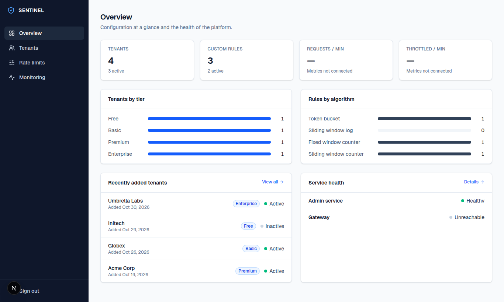
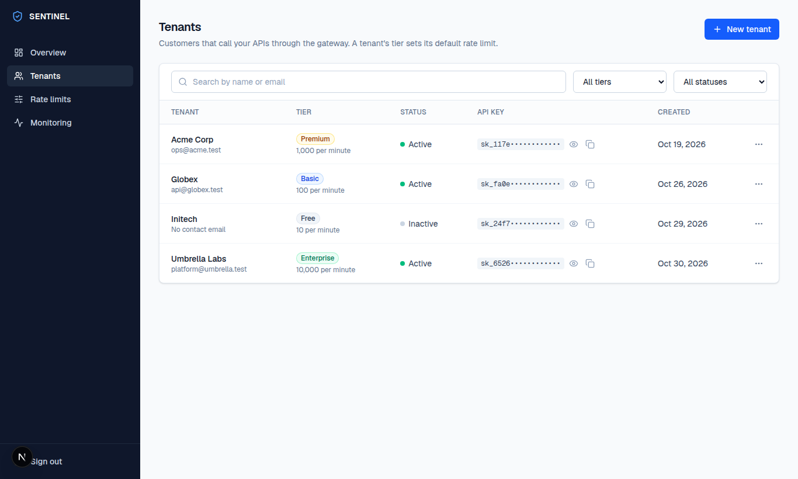
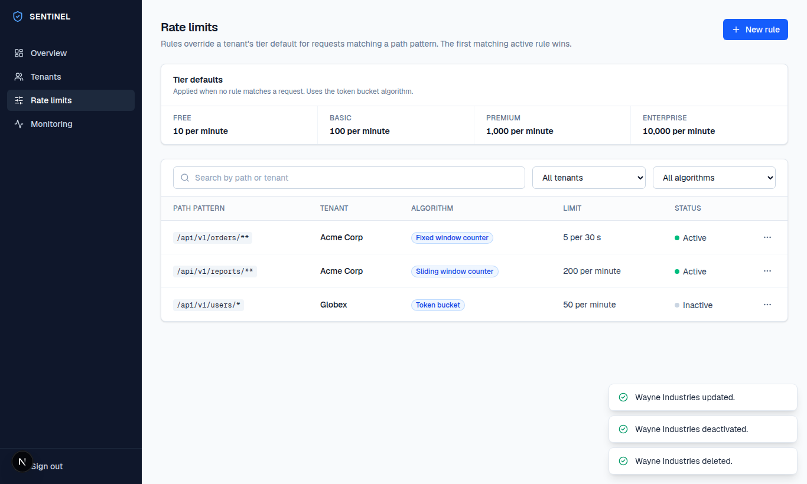

# SENTINEL - Scalable, Extensible, Network Traffic Intelligence Layer

A distributed rate limiter and API Gateway built with Java 17, Spring Cloud Gateway, Redis, and a modern React.js + Next.js admin dashboard.

## Overview

SENTINEL is a production-ready distributed API Gateway system that provides:
- **Multi-tenant rate limiting** with 4 pluggable algorithms
- **JWT authentication** for secure API access
- **Circuit breaking** with Resilience4j
- **Prometheus metrics** and Grafana monitoring
- **Per-tenant, per-endpoint configuration** via Admin Service
- **Redis-based distributed rate limiting** with Lua scripts
- **Modern React.js + Next.js admin dashboard** for easy management

## Architecture

```
┌─────────────────────────────────────────────────────────────┐
│                     SENTINEL Architecture                      │
├─────────────────────────────────────────────────────────────┤
│                                                              │
│  ┌──────────────┐      ┌──────────────┐                  │
│  │   Client     │─────▶│   Gateway    │                  │
│  └──────────────┘      └──────────────┘                  │
│         │                      │                           │
│         │                      ▼                           │
│         │              ┌──────────────┐                  │
│         │              │  JWT Auth    │                  │
│         │              └──────────────┘                  │
│         │                      │                           │
│         │              ┌──────────────┐                  │
│         │              │ Rate Limiter │                  │
│         │              └──────────────┘                  │
│         │                      │                           │
│         │              ┌──────────────┐                  │
│         │              │Circuit Breaker│                  │
│         │              └──────────────┘                  │
│         │                      │                           │
│         └──────────────────────┼───────────────────────┘
│                                │                           │
│                                ▼                           │
│         ┌─────────────────────────────────────────┐         │
│         │              Downstream Services          │         │
│         ├─────────────────────────────────────────┤         │
│         │  ┌──────────────┐  ┌──────────────┐   │         │
│         │  │Sample Service 1│  │Sample Service 2│   │         │
│         │  └──────────────┘  └──────────────┘   │         │
│         └─────────────────────────────────────────┘         │
│                                                              │
├─────────────────────────────────────────────────────────────┤
│                    Supporting Services                       │
├─────────────────────────────────────────────────────────────┤
│  ┌──────────────┐  ┌──────────────┐  ┌──────────────┐  │
│  │   Admin      │  │    Redis     │  │  PostgreSQL   │  │
│  │   Service     │  │              │  │              │  │
│  └──────────────┘  └──────────────┘  └──────────────┘  │
│                                                              │
├─────────────────────────────────────────────────────────────┤
│                    Monitoring & Observability                  │
├─────────────────────────────────────────────────────────────┤
│  ┌──────────────┐  ┌──────────────┐                      │
│  │  Prometheus  │  │   Grafana    │                      │
│  └──────────────┘  └──────────────┘                      │
│                                                              │
└─────────────────────────────────────────────────────────────┘
```

## Features

### Rate Limiting Algorithms

1. **Token Bucket** - Smooth rate limiting with token refill
2. **Sliding Window Log** - Precise request tracking with sorted sets
3. **Fixed Window Counter** - Simple counter-based limiting
4. **Sliding Window Counter** - Weighted window-based limiting

### Key Components

- **Gateway Service**: Spring Cloud Gateway with JWT auth and rate limiting
- **Admin Service**: REST API for tenant and rate limit configuration
- **Common Module**: Shared entities and enums
- **Infrastructure**: Docker Compose setup for development

## Quick Start

### Prerequisites

- Java 17+
- Maven 3.8+
- Docker & Docker Compose
- Node.js 18+ (for UI development)
- Git

### Installation

1. Clone the repository:
```bash
git clone <repository-url>
cd SENTINEL
```

2. Build the backend services:
```bash
mvn clean install
```

3. Build the UI (optional - Docker will build it):
```bash
cd sentinel-ui
npm install
npm run build
```

4. Configure secrets and start infrastructure:
```bash
cp .env.example .env   # then edit every value (JWT_SECRET, ADMIN_API_KEY, passwords)
docker-compose up -d
```

Build the images from the repository root (the Dockerfiles need the parent POM and `sentinel-common`):
`docker build -f sentinel-gateway/Dockerfile .`. Set `UI_ADMIN_USER`, `UI_ADMIN_PASSWORD` and
`SESSION_SECRET` to enable dashboard sign-in. Actuator endpoints (metrics, Prometheus) listen on
separate management ports (gateway 9080, admin 9081) that are not published to the host.

Clients obtain a JWT with `POST /auth/token` and the header `X-Tenant-Api-Key: <key>`, then call the
API with `Authorization: Bearer <jwt>`. Every response carries an `X-Request-Id` for tracing.

The admin API requires an `X-Admin-Key` header equal to `ADMIN_API_KEY`; the UI proxies
`/api/admin/*` to the admin service and adds it server-side. The gateway requires `JWT_SECRET`
(32+ bytes) and looks up each tenant's tier and rules from the admin service.

5. Access the services:
- **Admin Dashboard UI**: http://localhost:3000
- **Gateway Service**: http://localhost:8080
- **Admin Service API**: http://localhost:8081
- **Grafana**: http://localhost:3001 (admin/sentinel)
- **Prometheus**: http://localhost:9090

### Running Services Manually

#### Backend Services
```bash
# Admin Service
cd sentinel-admin && mvn spring-boot:run

# Gateway Service
cd sentinel-gateway && mvn spring-boot:run
```

#### UI Development
```bash
# Admin Dashboard UI
cd sentinel-ui
npm run dev
# Access at http://localhost:3000
```

### Running Tests

```bash
# Run all tests
mvn test

# Run specific module tests
cd sentinel-admin && mvn test
cd sentinel-gateway && mvn test
cd infrastructure && mvn test
```

## Configuration

### Application Properties

#### Gateway Service (`sentinel-gateway/src/main/resources/application.yml`)
- JWT secret and expiration
- Route definitions
- Resilience4j circuit breaker configuration
- Prometheus metrics configuration

#### Admin Service (`sentinel-admin/src/main/resources/application.yml`)
- Database configuration
- Redis configuration
- JPA/Hibernate settings

### Environment Variables

- `SPRING_PROFILES_ACTIVE`: Spring profile (default, test, prod)
- `JWT_SECRET`: JWT signing secret
- `DB_HOST`: Database host
- `REDIS_HOST`: Redis host

## Admin Dashboard UI

SENTINEL includes a modern React.js + Next.js admin dashboard for managing tenants, rate limits, and monitoring system performance.

### Dashboard Features

- **Overview Tab**: System statistics and recent activity
- **Tenants Tab**: Create, edit, and delete API tenants
- **Rate Limits Tab**: Configure rate limiting rules per tenant and endpoint
- **Monitoring Tab**: Real-time system health and performance metrics

### Dashboard Access

1. Navigate to http://localhost:3000
2. Click "Sign In" (demo mode - no authentication required)
3. Access all dashboard features

### UI Development

```bash
cd sentinel-ui
npm install
npm run dev        # Development server (http://localhost:3000)
npm run build      # Production build
npm run start      # Production server
npm test           # Run tests
```

### UI Configuration

Environment variables in `sentinel-ui/.env.local`:
```
NEXT_PUBLIC_API_URL=http://localhost:8081
```

### UI Components

- **TenantForm**: Modal for creating/editing tenants
- **RuleForm**: Modal for creating/editing rate limit rules
- **Dashboard**: Main dashboard with navigation
- **TenantsPage**: Tenant management interface
- **RateLimitsPage**: Rate limit configuration interface
- **MonitoringPage**: Real-time monitoring dashboard

## API Documentation

### Admin Service Endpoints

- `POST /api/v1/tenants` - Create tenant
- `GET /api/v1/tenants/{id}` - Get tenant by ID
- `GET /api/v1/tenants` - List all tenants
- `PUT /api/v1/tenants/{id}` - Update tenant
- `DELETE /api/v1/tenants/{id}` - Delete tenant

- `POST /api/v1/rules` - Create rate limit rule
- `GET /api/v1/rules/{id}` - Get rule by ID
- `GET /api/v1/rules` - List all rules
- `PUT /api/v1/rules/{id}` - Update rule
- `DELETE /api/v1/rules/{id}` - Delete rule

### Gateway Service Endpoints

- `GET /actuator/health` - Health check
- `GET /actuator/prometheus` - Prometheus metrics
- `GET /api/v1/users/**` - Users endpoint (via Sample Service 1)
- `GET /api/v1/products/**` - Products endpoint (via Sample Service 1)
- `GET /api/v1/analytics/**` - Analytics endpoint (via Sample Service 2)

## Rate Limiting

### Configuration

Rate limiting is configured per-tenant and per-endpoint through the Admin Service:

```json
{
  "tenantId": "tenant-uuid",
  "endpoint": "/api/v1/users",
  "algorithm": "TOKEN_BUCKET",
  "maxRequests": 100,
  "windowSeconds": 60
}
```

### Rate Limit Headers

When rate limiting is applied, the following headers are returned:

- `X-RateLimit-Limit`: Maximum requests allowed
- `X-RateLimit-Remaining`: Remaining requests
- `X-RateLimit-Reset`: Unix timestamp when the window resets

## Monitoring

### Prometheus Metrics

The Gateway Service exposes metrics at `/actuator/prometheus`:

- `http_server_requests_seconds_count`: Request count
- `http_server_requests_seconds_sum`: Request duration
- `resilience4j_circuitbreaker_state`: Circuit breaker state
- Custom rate limiting metrics

### Grafana Dashboard

A pre-configured Grafana dashboard is available at `http://localhost:3001` (default credentials: admin/sentinel).

## Development

### Project Structure

```
SENTINEL/
├── sentinel-common/          # Shared entities and enums
├── sentinel-gateway/        # API Gateway service
├── sentinel-admin/          # Admin service for configuration
├── sentinel-ui/             # React.js + Next.js admin dashboard
│   ├── src/
│   │   ├── app/             # Next.js app directory
│   │   ├── components/     # Reusable React components
│   │   ├── lib/            # Utility functions and API client
│   │   ├── services/        # API service functions
│   │   └── types/          # TypeScript type definitions
│   ├── public/              # Static assets
│   └── Dockerfile           # Docker configuration
├── infrastructure/          # Docker Compose and tests
├── downstream-services/    # Sample downstream services
├── load-tests/             # Gatling load tests
└── pom.xml                # Parent POM
```

### Adding New Rate Limiting Algorithms

1. Implement the `RateLimiter` interface
2. Add the algorithm to `AlgorithmType` enum
3. Register in `RateLimiterFactory`
4. Add unit tests

## Testing

### Unit Tests

- Entity tests: `*Test.java` in model packages
- Service tests: `*ServiceTest.java` in service packages
- Repository tests: `*RepositoryTest.java` in repository packages

### Integration Tests

- `IntegrationTest.java` in sentinel-admin
- `GatewayIntegrationTest.java` in sentinel-gateway
- Docker-dependent tests require `-Ddocker.tests.enabled=true`

### Load Tests

Gatling load tests are in the `load-tests` module:
```bash
cd load-tests
mvn gatling:test
```

## Deployment

### Docker Deployment

```bash
# Build Docker images
docker-compose build

# Start all services
docker-compose up -d

# View logs
docker-compose logs -f
```

### Kubernetes Deployment

Kubernetes manifests can be generated from the Docker Compose configuration using tools like Kompose.

## Troubleshooting

### Common Issues

1. **Redis connection failed**: Ensure Redis is running: `docker-compose up redis`
2. **Database connection failed**: Ensure PostgreSQL is running: `docker-compose up postgres`
3. **Rate limiting not working**: Check Redis connection and algorithm configuration
4. **JWT authentication failing**: Verify JWT secret matches between services

### Logs

- Gateway Service: `docker-compose logs sentinel-gateway`
- Admin Service: `docker-compose logs sentinel-admin`
- Redis: `docker-compose logs redis`
- PostgreSQL: `docker-compose logs postgres`

## Contributing

1. Fork the repository
2. Create a feature branch
3. Make your changes
4. Add tests
5. Run `mvn test`
6. Submit a pull request

## License

MIT License - see LICENSE file for details

## Contact

For questions or support, please open an issue in the repository.

## Documentation

- [`architecture/KT-guide.md`](architecture/KT-guide.md) - start here: a beginner-friendly walkthrough of the whole system
- [`architecture/PUBLISHING.md`](architecture/PUBLISHING.md) - how to publish the library to a Maven repository
- [`sentinel-spring-boot-starter/README.md`](sentinel-spring-boot-starter/README.md) - add rate limiting to your own Spring app as a dependency
- [`architecture/COMPARISON-AND-FAQ.md`](architecture/COMPARISON-AND-FAQ.md) - how SENTINEL differs from Spring Cloud Gateway and Spring AI, how customers use it, Maven publishing
- [`architecture/ARCHITECTURE.md`](architecture/ARCHITECTURE.md) - architecture reference
- [`architecture/diagrams/`](architecture/diagrams) - diagrams (PNG and SVG)

## Screenshots

The dashboard screens are in [`images/`](images): sign-in, overview, tenants, rate-limit rules,
monitoring and the mobile layout. They were captured against sample data.

| Overview | Tenants | Rate limits |
|---|---|---|
|  |  |  |
