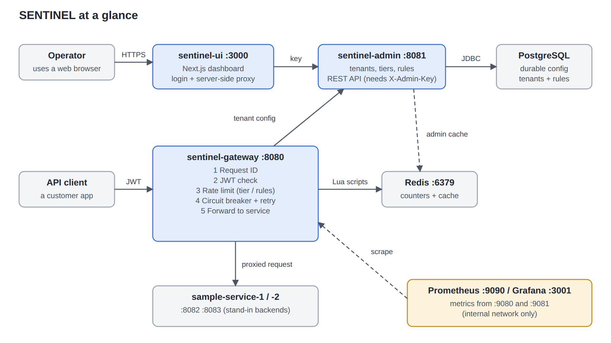
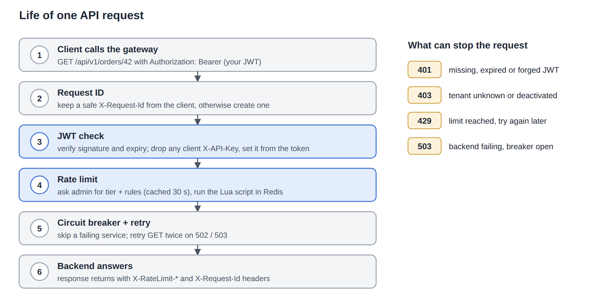
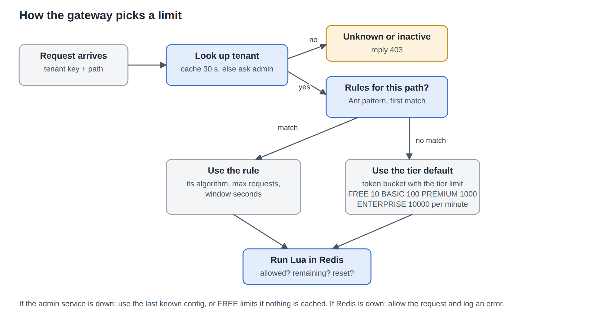
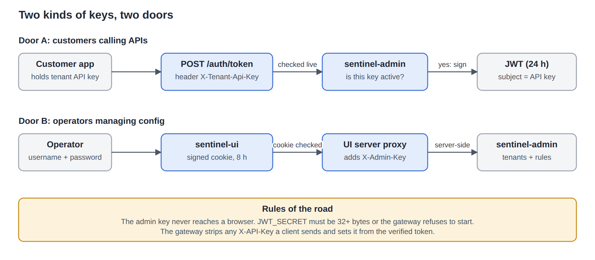

# SENTINEL – Knowledge Transfer (start here if you are new)

**Audience:** a new joiner who knows nothing about this project.  **Reading time:** about 25 minutes.
**Owner:** Rohit Jarariya.  **Source code:** the `SENTINEL` repository.

> **Related:** [comparison with Spring Cloud Gateway / Spring AI and common questions](COMPARISON-AND-FAQ.md).

> **How to read this page.** Part 1 explains the problem in plain words. Part 2 shows the system. Parts 3–6 explain each piece and *why* it exists. Parts 7–9 show you how to run it and where to change things. Part 10 is an honest list of what is not finished.

---

## 1. The problem, in plain words

Imagine a company that sells access to its data through web APIs. Many customers call those APIs all day. Three problems appear very quickly:

| Problem | Real-life picture | What SENTINEL does |
|---|---|---|
| **Who are you?** | A club needs a doorman checking IDs. | Checks a signed token (JWT) on every request. |
| **Too many requests** | One customer sends 1,000,000 calls and slows everyone else down (the *noisy neighbour*). | Counts requests per customer and answers **429 Too Many Requests** after the allowed number. |
| **A backend is broken** | If a restaurant kitchen is on fire you stop sending orders to it. | A **circuit breaker** stops sending traffic to a failing service and returns a friendly 503. |

SENTINEL is the doorman, the counter and the fuse box, placed in front of all backends. Backends stay simple because they no longer need to do these jobs themselves.

### Words you will meet (glossary)

| Word | Meaning here |
|---|---|
| **Gateway** | A single front door. All API traffic enters here first, then is forwarded to the right backend. |
| **Tenant** | One customer of the platform. Each tenant has an API key and a tier. |
| **Tier** | A plan: FREE, BASIC, PREMIUM or ENTERPRISE. The tier sets the default limit. |
| **Rule** | An override of the tier default for a specific URL pattern (for example, `/api/v1/orders/**` gets 5 requests per 30 s). |
| **API key** | The tenant's long-lived secret, like `sk_3f9a…`. Never sent to backends, only exchanged for a token. |
| **JWT** | A short-lived signed pass (valid 24 h). The gateway checks the signature without any database call. |
| **Rate limit** | The maximum number of requests allowed in a time window. |
| **Redis** | A very fast in-memory store. Holds the request counters, shared by all gateway instances. |
| **Lua script** | A tiny program that runs *inside* Redis, so the "read counter, decide, update counter" steps happen as one unbreakable action. |
| **Circuit breaker** | A safety switch that stops calling a service that keeps failing, then tries again after a pause. |
| **Actuator** | Spring Boot's built-in health and metrics endpoints. |

---

## 2. The system on one page



**How to read the picture.** Blue boxes are the SENTINEL services we wrote. Grey boxes are data stores and outside parties. The amber box is monitoring. Solid arrows are normal calls; dashed arrows are supporting traffic (cache, metrics).

**The two flows to remember:**

1. **Customer traffic** goes *Client → Gateway → Backend*. It never touches PostgreSQL.
2. **Management traffic** goes *Operator → UI → Admin → PostgreSQL*. It never touches customer traffic.

> **Why split gateway and admin?** The gateway is on the hot path and must be fast and stateless, so it can be copied many times. Admin handles rare configuration changes and needs a database. Keeping them separate means a slow database never slows customer requests. The gateway only asks admin for a tenant's settings and remembers the answer for 30 seconds.

### What each folder is

| Folder | What it is | Port |
|---|---|---|
| `sentinel-gateway` | Spring Cloud Gateway: authentication, rate limiting, circuit breaker, routing | 8080 (metrics 9080) |
| `sentinel-admin` | REST API to create tenants and rules; stores them in PostgreSQL | 8081 (metrics 9081) |
| `sentinel-common` | Small shared code: the `Tier` and `AlgorithmType` enums | – |
| `sentinel-ui` | Next.js dashboard for operators | 3000 |
| `downstream-services/sample-service-1, -2` | Pretend customer backends for demos | 8082, 8083 |
| `infrastructure` | Tests that check docker-compose, CI and the project layout | – |
| `load-tests` | Load-test module | – |
| `docker-compose.yml` | Starts everything together | – |

---

## 3. Following one request (the most important section)



Take a customer calling `GET /api/v1/orders/42`. Here is what each step does and **why**.

**Step 1 – The client calls the gateway.** The call carries `Authorization: Bearer <JWT>`.

**Step 2 – Request ID.** The gateway makes sure the request has an `X-Request-Id`. If the client sent a safe one, it is kept; otherwise a new one is created. It is added to the response and to the forwarded call.
*Why:* when something goes wrong you can search the logs of the gateway *and* the backend for one id and see the whole story.

**Step 3 – JWT check.** The filter in `JwtAuthenticationFilter` verifies the signature and the expiry date. Then it **deletes any `X-API-Key` header sent by the client** and sets a new one taken from the token.
*Why:* an earlier version only *added* the header, so a client could invent its own `X-API-Key` on every request. Each fake key got its own fresh counter, which meant no limit at all, and it could also pretend to be another customer. Removing the client's header closes that hole.

**Step 4 – Rate limit.** `RateLimitFilter` asks the admin service for this tenant's tier and rules (answers are remembered for 30 seconds), picks the limit that applies, and runs the matching Lua script in Redis.
*Why ask admin?* So limits can be changed from the dashboard without redeploying anything.

**Step 5 – Circuit breaker and retry.** Each route is wrapped by a circuit breaker. If a backend keeps failing, the breaker "opens" and the gateway answers **503** immediately with a friendly message (`FallbackController`) instead of making the client wait. GET calls are retried twice on 502/503.
*Why only GET?* Repeating a GET is harmless. Repeating a POST could create two orders.

**Step 6 – The backend answers.** The response comes back with `X-RateLimit-Limit`, `X-RateLimit-Remaining`, `X-RateLimit-Reset` and `X-Request-Id`.

### What the client can see when it is stopped

| Code | Meaning | Step |
|---|---|---|
| **401** | Missing, expired or forged token | 3 |
| **403** | Tenant unknown or deactivated | 4 |
| **429** | Limit reached; try again later | 4 |
| **503** | Backend failing; breaker is open | 5 |

---

## 4. Tenants, tiers and rules: how a limit is chosen



Read the diagram top to bottom:

1. The gateway looks up the tenant (cache first, then the admin service).
2. **Unknown or deactivated tenant → 403.**
3. Otherwise it checks the tenant's **rules**. A rule has a URL pattern such as `/api/v1/orders/**` (`*` means one path part, `**` means any depth). The **first matching active rule wins** and supplies the algorithm, the maximum requests and the window in seconds.
4. If no rule matches, the **tier default** is used with the token bucket algorithm:

| Tier | Requests per minute |
|---|---|
| FREE | 10 |
| BASIC | 100 |
| PREMIUM | 1,000 |
| ENTERPRISE | 10,000 |

> **Why tiers *and* rules?** Tiers give a simple commercial model with zero setup per URL. Rules handle special cases (for example, protect an expensive report endpoint more strictly).

**What happens when things break (a deliberate decision):**

| Failure | Behaviour | Reason |
|---|---|---|
| Admin service unreachable | Use the last known settings; if there are none, use FREE limits | A short admin outage must not stop traffic, and a low limit is safer than no limit. |
| Redis unreachable | **Allow** the request and log an error | We chose availability over strictness. This is a business choice and can be flipped to "deny" in `RateLimitFilter`. |
| Token requested while admin is down | **503**, no token | Handing out tokens without checking the key would be unsafe. |

---

## 5. The four rate-limit algorithms

All four run as Lua scripts in Redis. All four answer the same question: *may this request pass?*

> **Why Lua?** Imagine two gateway copies handling request number 100 at the same moment. Without Lua, both read "99 used", both allow it, and the limit is exceeded. A Lua script runs as one unbreakable step in Redis, so the second copy sees "100 used".

| Algorithm | Plain-words picture | Strength | Weakness |
|---|---|---|---|
| **Token bucket** (default) | A bucket holds up to N tokens and refills steadily. Each request takes a token. | Allows a short burst, then a steady rate. | Two values stored per key. |
| **Fixed window counter** | Count requests in each calendar minute; reset at the boundary. | Simplest, cheapest. | A client can send 2× the limit across a boundary (end of one minute plus start of the next). |
| **Sliding window log** | Remember the time of every request; count those in the last N seconds. | Exactly correct. | Memory grows with traffic. |
| **Sliding window counter** | Keep a count per 10-second slice; add up the slices in the window. | Almost exact, small memory. | Precision limited to 10 s. |

Redis keys look like `token_bucket:<api key>:<METHOD>:<path>`. So every tenant gets its own counter *per endpoint*.

**Two bugs worth knowing about (they teach how the code works):**
- *Sliding window counter* once deleted old entries using the wrong field, so every entry was deleted on every call and nothing was ever blocked.
- *Token bucket* once moved its "last refill" time forward even when no whole token had been earned. With slow rates (for example 10 per minute) steady traffic never got tokens back. It now only advances by the time that was actually turned into whole tokens.

Both are covered by `RedisLimitersIntegrationTest`, which runs the real code against a real Redis.

---

## 6. Security: who holds which key



There are **two separate doors**, on purpose.

**Door A – customers calling APIs.**
1. The customer sends its API key to `POST /auth/token` in the header `X-Tenant-Api-Key`.
2. The gateway asks admin *live* (no cache) whether the key is active.
3. If yes, the gateway signs a JWT (valid 24 hours) and returns it.
4. The customer uses `Authorization: Bearer <JWT>` from then on.

*Why a JWT instead of the key on every call?* The key is a long-lived secret; sending it everywhere increases the chance of a leak. A JWT expires by itself. Checking a JWT needs no database call, which keeps the gateway fast.

**Door B – operators managing configuration.**
1. The operator signs in on the dashboard. The server checks the username and password and sets a signed, `HttpOnly` cookie valid for 8 hours.
2. Every dashboard page and every `/api/admin/*` call is checked by `proxy.ts`. No valid cookie means a redirect (pages) or 401 (API).
3. The UI's *server* adds the secret `X-Admin-Key` header and forwards the call to admin.

*Why a proxy?* If the admin key were in browser JavaScript, anyone who opens the page could copy it.

### Security rules that must not be broken

| Rule | Why |
|---|---|
| `JWT_SECRET` must be at least 32 bytes; the gateway refuses to start without it | A default secret in source code lets anyone forge tokens. |
| The admin API needs `X-Admin-Key` (compared in constant time; if no key is configured everything is rejected) | The admin API can create tenants and read API keys. |
| API keys are 192 random bits from a secure random generator | They are credentials; they must not be guessable from a tenant name. |
| Metrics and health run on separate ports (9080, 9081) not published to the host | Metrics reveal internals. |
| Postgres and Redis listen on `127.0.0.1` only; secrets live in `.env` (git-ignored) | Do not expose data stores or commit passwords. |
| Errors never include stack traces or secrets (`GlobalExceptionHandler`) | Attackers learn from error messages. |

---

## 7. Run it yourself

> **Status note.** The Java build could not be compiled in the environment where this documentation was written (no access to the Maven repository). Treat the commands below as the intended path and report anything that fails.

**Prerequisites:** Docker + Docker Compose, Java 17, Maven 3.8+, Node 20+.

```bash
cp .env.example .env        # then edit EVERY value
docker-compose up --build -d
```

| What | Where |
|---|---|
| Dashboard | http://localhost:3000 (sign in with `UI_ADMIN_USER` / `UI_ADMIN_PASSWORD`) |
| Gateway | http://localhost:8080 |
| Admin API | http://localhost:8081 (needs `X-Admin-Key`) |
| Prometheus / Grafana | http://localhost:9090 / http://localhost:3001 |

> If port 8081 or 3000 is already used on your machine, stop that program first or change the published port in `docker-compose.yml`.

### Five-minute walkthrough (see it work end to end)

```bash
# 1. Create a tenant (you are the operator; use the admin key from .env)
curl -s -X POST localhost:8081/api/v1/admin/tenants \
  -H "X-Admin-Key: $ADMIN_API_KEY" -H "Content-Type: application/json" \
  -d '{"name":"Acme","tier":"FREE","contactEmail":"ops@acme.test"}'
# copy "apiKey" from the answer

# 2. Swap the API key for a JWT (you are now the customer)
curl -s -X POST localhost:8080/auth/token -H "X-Tenant-Api-Key: <apiKey>"
# copy "token" from the answer

# 3. Call a backend through the gateway, 12 times
for i in $(seq 1 12); do
  curl -s -o /dev/null -w "%{http_code}\n" \
    -H "Authorization: Bearer <token>" localhost:8080/api/v1/users/1
done
```

Expected result for a FREE tenant: ten `200` answers, then `429`. Look at the response headers (`curl -i`) to see `X-RateLimit-Remaining` count down.

### Run the tests

```bash
mvn test                                  # all modules
mvn test -pl sentinel-gateway             # one module
```

`RedisLimitersIntegrationTest` starts a real Redis in Docker and is skipped automatically when Docker is not available.

### Run only the dashboard for UI work

```bash
cd sentinel-ui
export UI_ADMIN_USER=admin UI_ADMIN_PASSWORD=choose-one \
       SESSION_SECRET=a-random-string-of-at-least-32-characters \
       ADMIN_API_URL=http://localhost:8081 ADMIN_API_KEY=<same as admin>
npm install && npm run dev
```

---

## 8. Where is the code? (map for changes)

| I want to… | Look here |
|---|---|
| Change how tokens are checked | `sentinel-gateway/.../security/JwtAuthenticationFilter.java`, `JwtUtil.java` |
| Change how a limit is chosen | `sentinel-gateway/.../ratelimit/RateLimitFilter.java` (`resolveLimit`) |
| Change or add an algorithm | `sentinel-gateway/.../ratelimit/*RateLimiter.java` (Lua is inside each class), `RateLimiterFactory.java` |
| Change what happens when Redis fails | `RateLimitFilter.java` (`onErrorResume`) |
| Change how the gateway asks admin | `sentinel-gateway/.../config/TenantConfigClient.java` |
| Add or change a route / breaker / retry | `sentinel-gateway/src/main/resources/application.yml` |
| Change the token endpoint | `sentinel-gateway/.../security/TokenController.java` |
| Change tenant or rule APIs | `sentinel-admin/.../controller/`, `service/` |
| Change database tables | New file in `sentinel-admin/src/main/resources/db/migration/` (Flyway, never edit old files) |
| Change error messages | `sentinel-admin/.../exception/GlobalExceptionHandler.java` |
| Change admin authentication | `sentinel-admin/.../security/AdminApiKeyFilter.java` |
| Change tier defaults | `sentinel-common/.../enums/Tier.java` |
| Change login or session | `sentinel-ui/src/lib/session.ts`, `src/proxy.ts`, `src/app/api/login` |
| Change the dashboard pages | `sentinel-ui/src/app/dashboard/` |

### Configuration cheat-sheet

| Variable | Used by | Meaning |
|---|---|---|
| `JWT_SECRET` | gateway | Token signing key, 32+ bytes. **Required.** |
| `ADMIN_API_KEY` | admin, gateway, UI | Shared key for the admin API. **Required.** |
| `ADMIN_URL` | gateway | Where the gateway finds admin. |
| `SAMPLE_SERVICE_1_URL`, `SAMPLE_SERVICE_2_URL` | gateway | Backend addresses (default localhost). |
| `POSTGRES_PASSWORD` | compose, admin | Database password. |
| `GRAFANA_PASSWORD` | compose | Grafana admin password. |
| `UI_ADMIN_USER`, `UI_ADMIN_PASSWORD` | UI | Dashboard sign-in. |
| `SESSION_SECRET` | UI | Signs the session cookie, 32+ chars. |
| `ADMIN_API_URL` | UI (server side) | Where the UI proxy forwards. |

---

## 9. Common problems and what they mean

| Symptom | Likely cause |
|---|---|
| Gateway will not start: "jwt.secret … must be set" | `JWT_SECRET` missing or shorter than 32 bytes. |
| Every admin call returns 401 | `X-Admin-Key` missing/wrong, or `ADMIN_API_KEY` not set on admin (it rejects everything when unset). |
| `POST /auth/token` returns 401 | Key unknown or tenant deactivated. |
| `POST /auth/token` returns 503 | Gateway cannot reach admin. |
| Calls return 403 | Token is valid but the tenant was deleted or deactivated. |
| 429 sooner than expected | Check the tenant's tier and any rule for that URL. |
| 503 with "upstream service is temporarily unavailable" | The circuit breaker is open; the backend is failing. It retries on its own after a pause. |
| Dashboard keeps returning to the sign-in page | Session expired (8 h), or `SESSION_SECRET` changed. |
| Dashboard says the admin service is unavailable (502) | UI cannot reach `ADMIN_API_URL`. |
| Port already in use | Another program owns 3000/8080/8081; stop it or change the published port. |

---

## 10. Honest status: what is not finished

| Item | Why it matters |
|---|---|
| Java code and Docker images were not compiled in the authoring environment | Run `mvn test` and `docker-compose up --build` first and fix any surprises. |
| API keys are stored in plain text in PostgreSQL | Ideal: store only a hash and show the key once at creation. |
| The dashboard has one shared login | No per-person accounts, roles or audit trail yet. |
| The UI was rebuilt against the real admin API and tested against a stand-in admin server, not the real Java service | Re-test the Tenants and Rate limits tabs once the real stack runs. |
| Traffic numbers on Overview and Monitoring need `PROMETHEUS_URL` and a Prometheus that scrapes the gateway | Otherwise they show a "not connected" notice. The metric name used is `spring_cloud_gateway_requests_seconds_count`; confirm it on first run. |
| `POST /auth/token` has no limit of its own | Keys are long and random, but a limit would add protection. |
| Retries apply to GET only | Safe by design; a POST needs an idempotency key before it can be retried. |

---

## 11. First-week checklist for a new joiner

1. Read Parts 1–3 and be able to explain the six steps of a request out loud.
2. Start the stack and do the five-minute walkthrough.
3. Read `RateLimitFilter.java` and `TenantConfigClient.java` (about 150 lines in total).
4. Run `mvn test`; read `RedisLimitersIntegrationTest` to see how a limiter is tested.
5. Change a tier default in `Tier.java`, rebuild, and watch the 429 threshold move.
6. Pick one item from Part 10 and propose a fix.
